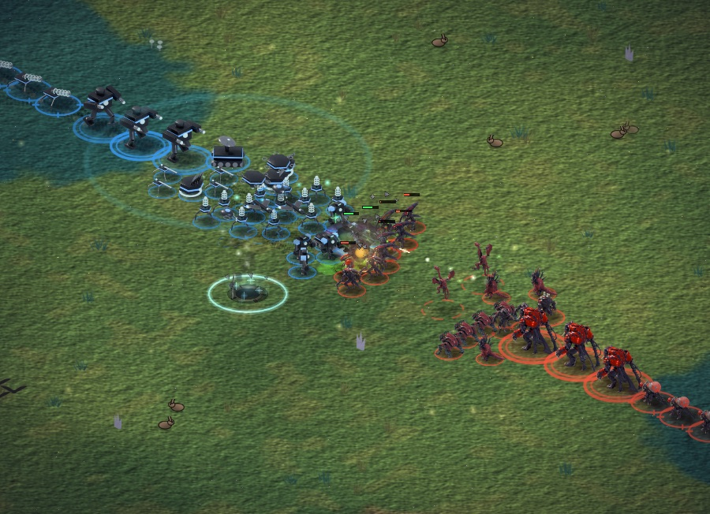
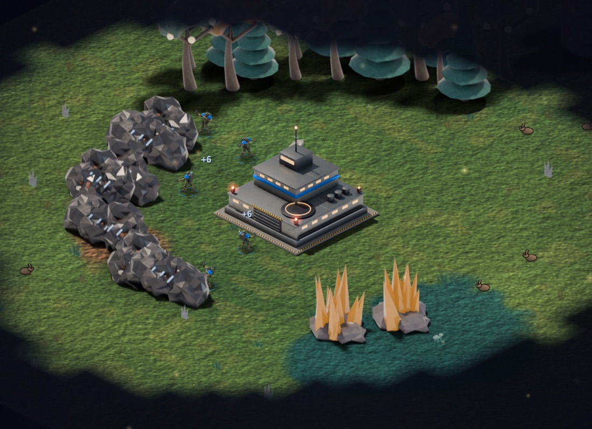
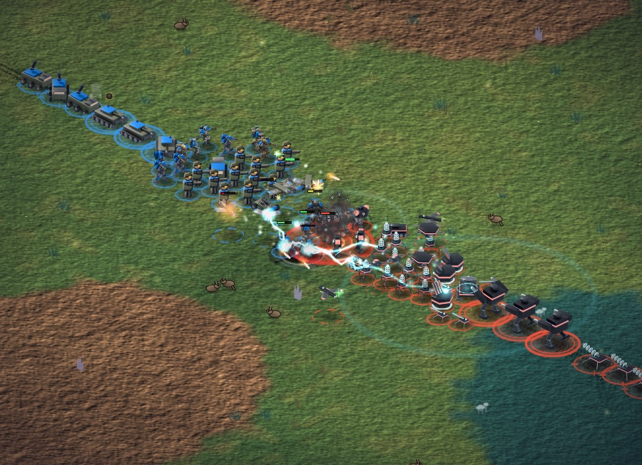
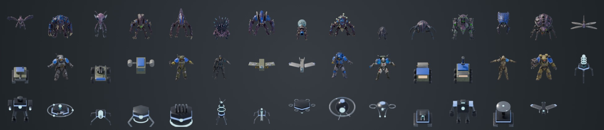
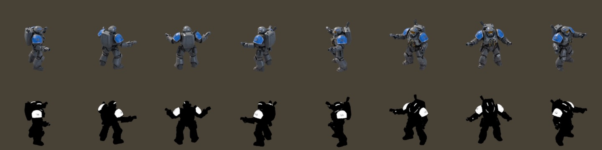
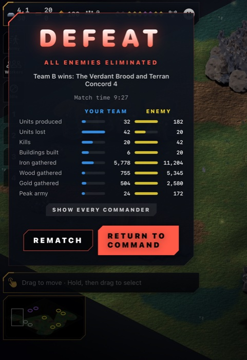

# Michael Perry

**Operations leader who builds AI workflows that people can actually trust.**

I've spent over a decade in manufacturing operations: first in clean-room medical device packaging at DePuy Synthes (Johnson & Johnson), and since 2020 as Director of Logistics at a custom manufacturer, where I was one of three people who rebuilt operations from the ground up after the entire management team left at once. I designed the BOM and traveler system that tracks every build step with built-in quality checks, and it **cut errors by 40%.** I also built the serial-number system, the location tracking for roughly 3,000 warehouse parts, and the QC, safety, and RMA processes.

That work taught me to ask a few questions of any process: *What's the source of truth? What needs human judgment? What happens when information is uncertain? Can we reconstruct what happened?* I now ask the same questions about AI.

## How I work

I'm not a traditional software engineer, and I don't pretend to be. I work like a technical lead: I map the process, define the rules and boundaries, write the specification and tests, and direct AI coding agents to build it. Then I have a *second* model review the work, because the one who built it shouldn't be the one who signs off on it.

## Projects

| Project | What it shows | Status |
|---|---|---|
| **[Operations Forecasting](https://github.com/perry-is/operations-forecasting-system)** | Excel in, planning workbook out: inventory forecasts and reorder recommendations. It withholds numbers when the data is bad, and old forecasts can't be rewritten after the fact. | Rebuilt from a tool I built and used in my logistics job |
| **[Coral](https://github.com/perry-is/coral-portfolio)** | A private AI layer that decides what each model is allowed to see, refuses rather than leaking, and keeps receipts of every decision. Optional local model via Ollama. | Public slice of a personal system I'm building |
| **[AI Bookkeeping Workflow](https://github.com/perry-is/ai-bookkeeping-workflow)** | Plain-English bookkeeping rules turned into enforced logic. AI may *suggest* a category, but suggestions always go to human review and never touch the totals. | Built from my own business's bookkeeping procedure |
| **[AI Content Operations](https://github.com/perry-is/ai-content-operations-pipeline)** | One podcast episode in, six publishing outputs out, with rules that stop AI from inventing exercises or links. | Modeled on the system I use for my podcast and workshops |
| **[Coral Forge](https://github.com/perry-is/coral-forge)** | A bounded loop for AI coding agents: allow-listed actions, tests as the judge, hard retry limit. | Experimental demonstration |

All public repos use fictional data. The real versions hold personal, client, or business information, which doesn't belong on GitHub.

## App development

I build apps the same way I build the workflows above. I write the spec, scope and acceptance tests first. AI coding agents write the code, and the tests decide when it's done.

### [Meridian: Three Fronts](https://github.com/perry-is/Meridian)

**An original isometric sci-fi real-time strategy game for iPhone and Mac.** It has three asymmetric factions, 44 units and 24 buildings, an economy and tech tree, fog of war, and a computer opponent that scouts, expands and counters what you build.

| | |
|---|---|
|  |  |

- **3D-to-sprite art pipeline.** Each unit starts as a concept image and is turned into a 3D model in Tripo. Buildings are modelled in Blender with Python. Everything is then rendered into animated isometric sprites with 8 facings and team-colour masks, and humanoids move with retargeted motion capture.

  
  

- **The game rules are a tested Swift package.** The simulation is deterministic, and a save/load round-trip test proves a restored match plays out identically. A headless tournament harness pits AIs against each other to balance the factions.
- **Every feature is checked with screenshots.** UI tests drive the game on the simulator and save a picture of each step. A feature isn't done until those pictures show it working.

  
  &nbsp;
  

*Swift · SpriteKit · SwiftUI · Blender (Python) · Tripo · about 20,000 lines of Swift*

### [Show Stand](https://github.com/perry-is/show-stand)

**Turns an iPhone or iPad into a branded booth display that captures leads, fully offline.** I built it for small vendors at markets and conferences. Visitors scan a QR code or leave their name and email, the leads sit behind Face ID, and they export to CSV. The app makes zero network calls and has no accounts or analytics.

The repo includes a fictional demo booth: pick the **ShowStand Demo** scheme in Xcode and run it.

*Swift · SwiftUI · SwiftData · Core Image · LocalAuthentication*

## What ties it together

**Model output is not a business fact.** AI can propose a record, a category, or a draft. In every project here, that proposal either has to pass rules a person can read or waits in a queue for a person, and none of it becomes official on its own.

## Background

- Director of Logistics, custom manufacturing (2020–present): inventory, purchasing, QC, travelers, BOMs, supplier relations
- Senior Packager, DePuy Synthes / Johnson & Johnson (2011–2017): ISO clean room, SAP
- A.A. in Psychology
- Facilitator and teacher: workshops on leadership, communication, and change

**Tools I work with:** Python · Swift, SwiftUI and SpriteKit · Xcode · Blender (Python) · SQLite · Git and GitHub Actions · Ollama and local LLMs · OpenAI and Anthropic models · Claude Code and Codex · Excel and openpyxl · Home Assistant

**Website:** [perry.is](https://perry.is)
